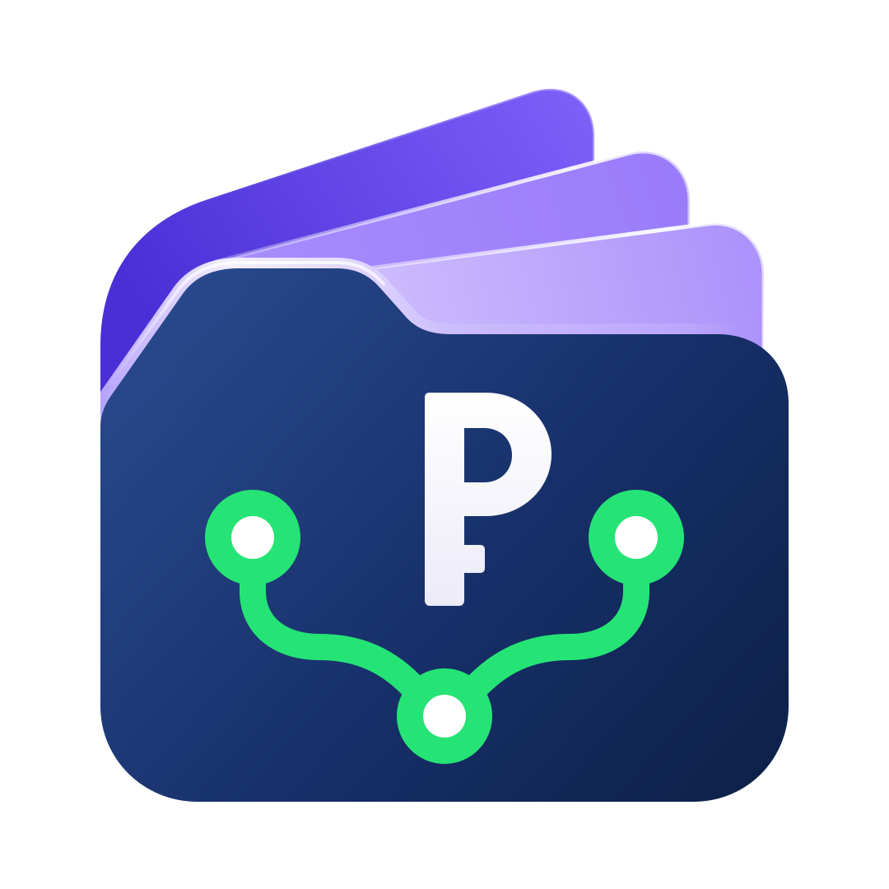

<p align="center">
  
</p>

# Passel

A password manager for **Linux**, **Windows** and **Android**, built on
the [pass](https://www.passwordstore.org/) standard. Written in Rust ❤️

Your passwords stay in plain `pass` vaults: one OpenPGP-encrypted file
per entry, in a git repository you own. No account, no cloud service,
no lock-in: Passel, the `pass` CLI and every other `pass` client read
and write the same vault.

- **Encrypted with your own OpenPGP key**: create one in the setup
  wizard, or use the key you already have.
- **Synced with git**: any private remote (GitHub, GitLab, Gitea, your
  own server). Changes made on the phone and on the computer merge;
  nothing is lost when the same entry changed on both sides.
- **Several vaults**: personal, work, shared with a team, each with its
  own remote.
- **Entries with fields**: passwords, usernames, URLs, notes, one-time
  password (TOTP) codes, and a password generator.
- **History**: see what changed, revert an entry or roll back the vault.
- **Careful with secrets**: copied passwords are cleared from the
  clipboard, secrets are hidden from input methods, and from
  screenshots on Android.
- In English, French, German, Spanish and Brazilian Portuguese.

## Platforms

| Platform | App | Get it |
| --- | --- | --- |
| Linux | GTK4 + Adwaita | `.deb` and Arch tarball on the [releases](https://github.com/Pierrotws/passel/releases), `passel` / `passel-bin` on the AUR, or [build it](#install) |
| Windows | GTK4 + Adwaita | `passel-<version>-x86_64-setup.exe` on the [releases](https://github.com/Pierrotws/passel/releases), with [Gpg4win](https://gpg4win.org); see [packaging/windows](packaging/windows/README.md) |
| Android | Kotlin + Jetpack Compose | Google Play (internal testing for now); see [android/](android/README.md) |

All of them share one Rust core ([`crates/passel-core`](crates/passel-core)):
the vault format, encryption, git sync and setup. The desktop app uses
GnuPG; Android uses [rPGP](https://github.com/rpgp/rpgp), and both open
the same vault with the same key.

Desktop stack:
- Adwaita
- Gtk-rs
- blueprint

## Requirements (build or dev)

- rust or rustup
- meson
- gettext (msgfmt compiles the translations)

Optional for UI development:
- blueprint-compiler

Use rustup if you require multiples rust env (similarly to other tools like pyenv, nvm, rbenv, …)

`blueprint-compiler` is only required when editing `.blp` UI files. Release tarballs ship generated `.ui` files, so they can be built without it.

## Usage (desktop)

On first launch, the setup wizard creates or imports your OpenPGP key
and creates a vault, or downloads an existing one from its git remote.
The `pass` CLI is not required, but works alongside Passel.

Syncing needs a private git remote with working access (a git
credential helper, or SSH). The default vault is `~/.password-store`,
like `pass`; `PASSWORD_STORE_DIR` overrides it.

## Install

```bash
meson setup build --prefix="$HOME/.local"
meson compile -C build
meson install -C build
```

To force a build that does not use `blueprint-compiler`:

```bash
meson setup build --prefix="$HOME/.local" -Dblueprint=disabled
meson compile -C build
meson install -C build
```

## Dev

Run only once!

```bash
meson setup build
```

Install `blueprint-compiler` for development so changes to `assets/ui/**/*.blp` are compiled into the GTK templates.

### Compile

```bash
cd build;
meson compile
```

### Run

Dev-only for now:
```bash
cd build;
./target/debug/passel
```

Debug builds never touch your real `~/.password-store`: they use
`.dev-password-store/` at the repo root (git-ignored) regardless of
`PASSWORD_STORE_DIR` or the `store-dir` preference. Set
`PASSEL_DEV_STORE_DIR` to use another sandbox. The first launch
opens the setup wizard to create it.

### Test

```bash
cd build
cargo test --workspace
```

### Translations

Passel is in English, French, German, Spanish and Brazilian
Portuguese. All targets (desktop, Android, later
iOS) share the gettext catalogs in [`po/`](po/README.md): how to write
translatable messages, refresh the catalogs (`po/update.sh`) and add a
language. To try a language without changing the session's:

```bash
LANGUAGE=fr ./build/target/debug/passel
```

### Android

The Android app lives in [`android/`](android/README.md): how to build
it, how it fits on the Rust core, and how releases reach Google Play.

### Doc

```bash
cd build
cargo doc
```


## Thanks

- zx2c4 for the great standard unix password
  manager
- The Gnome Project ❤️
